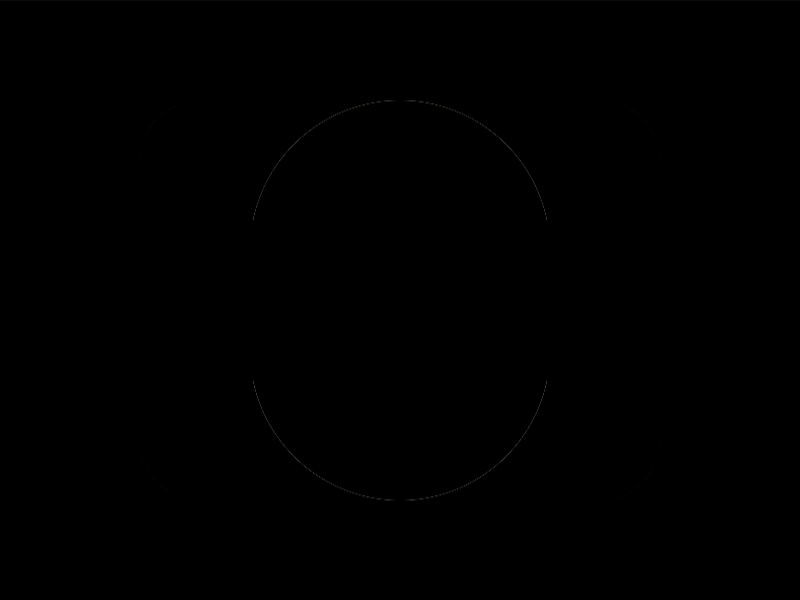
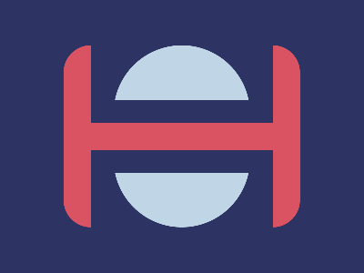

# Daily Target — Oct 18, 2026

Challenge: <https://cssbattle.dev/play/W7SWtIqYNFiLhipGj6bj>

## Result

<table>
	<tr>
		<th width="50%">User Submission</th>
		<th width="50%">Target</th>
	</tr>
	<tr>
		<td width="50%" align="center">
			
		</td>
		<td width="50%" align="center">
			
		</td>
	</tr>
</table>

## Code

```html
<style>
&{
  margin:50 70;
  background:#D95362;
 border-radius:30px;
  box-shadow:0 0 0 9in#2D3464;
  *{
    background:
      radial-gradient(
        1q at 50% 100px,
        #C0D6E7 75px,
      #2D3464  
      )0 60px
      ;
    margin: 0 30 115;
    -webkit-box-reflect:below 30px;
  }
  
 }
```

## Prettified code

```html
<style>
&{
  margin:50 70;
  background:#D95362;
 border-radius:30px;
  box-shadow:0 0 0 9in#2D3464;
  *{
    background:
      radial-gradient(
        1q at 50% 100px,
        #C0D6E7 75px,
      #2D3464  
      )0 60px
      ;
    margin: 0 30 115;
    -webkit-box-reflect:below 30px;
  }
  
 }
```
