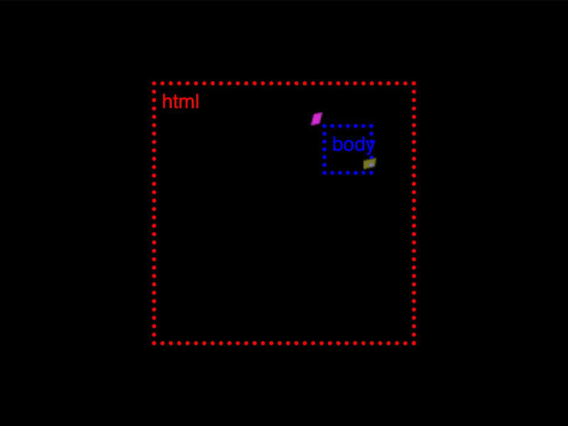

# Daily Target — Nov 2, 2026

Challenge: <https://cssbattle.dev/play/yqo0rTLub7PXnnSupZQT>

## Result

<table>
	<tr>
		<th width="50%">User Submission</th>
		<th width="50%">Target</th>
	</tr>
	<tr>
		<td width="50%" align="center">
			
		</td>
		<td width="50%" align="center">
			
		</td>
	</tr>
</table>

## Code

```html
<style>&{background:#492FB0;border:double;border-width:0 0 90 90;margin:60 110;color:#DB5EAD;*{margin:30;box-shadow:5vh -5vh 0 5vh
```

## Prettified code

```html
<style>
& {
  background: #492fb0;
  border: double;
  border-width: 0 0 90 90;
  margin: 60 110;
  color: #db5ead;
  * {
    margin: 30;
    box-shadow: 5vh -5vh 0 5vh;
  }
}

</style>
```
