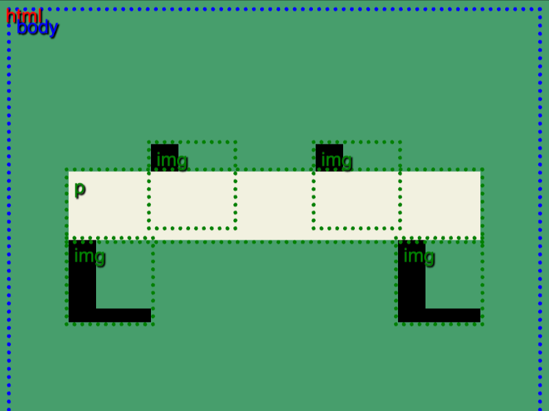
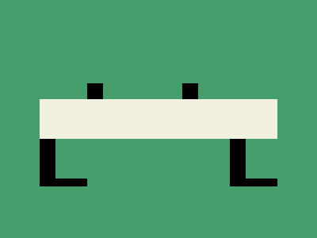

# Daily Target — Nov 7, 2026

Challenge: <https://cssbattle.dev/play/QYh1So3F1gjsyf4gTzmp>

## Result

<table>
	<tr>
		<th width="50%">User Submission</th>
		<th width="50%">Target</th>
	</tr>
	<tr>
		<td width="50%" align="center">
			
		</td>
		<td width="50%" align="center">
			
		</td>
	</tr>
</table>

## Code

```html
<p><style>&{background:#469E6C;img{margin:97 102;padding:25 20;border:solid;border-width:0 0 10 20;+*{margin:-157 222;+*{margin:-87 42;+*{margin:-87 282}}}}p{height:50;background:#F2F1E0;margin:-137 42;scale:1
```

## Prettified code

```html
<p>
<style>
& {
  background: #469e6c;
  img {
    margin: 97 102;
    padding: 25 20;
    border: solid;
    border-width: 0 0 10 20;
    + * {
      margin: -157 222;
      + * {
        margin: -87 42;
        + * {
          margin: -87 282;
        }
      }
    }
  }
  p {
    height: 50;
    background: #f2f1e0;
    margin: -137 42;
    scale: 1;
  }
}
</style>
```
