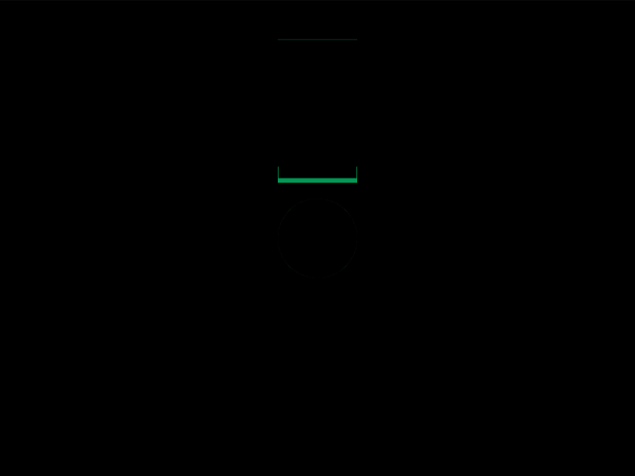
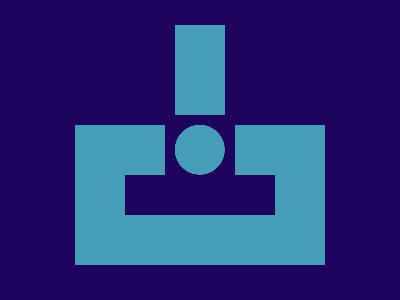

# Daily Target — Nov 9, 2026

Challenge: <https://cssbattle.dev/play/V3rcPynSdxNerqyJeVdL>

## Result

<table>
	<tr>
		<th width="50%">User Submission</th>
		<th width="50%">Target</th>
	</tr>
	<tr>
		<td width="50%" align="center">
			
		</td>
		<td width="50%" align="center">
			
		</td>
	</tr>
</table>

## Code

```html
<style>*{background:#1d025e}&{margin:125 75 35;color:469DBA;border:53q solid;*{margin:-60 40 0;box-shadow:0-5lh 0-11q,0-106q 0-10px;*{margin:10;border-radius:9in;border:25px solid
```

## Prettified code

```html

<style>
* {
  background: #1d025e;
}
& {
  margin: 125 75 35;
  color: 469DBA;
  border: 53Q solid;
  * {
    margin: -60 40 0;
    box-shadow:
      0 -5lh 0 -11Q,
      0 -106Q 0 -10px;
    * {
      margin: 10;
      border-radius: 9in;
      border: 25px solid;
    }
  }
}
</style>
```
