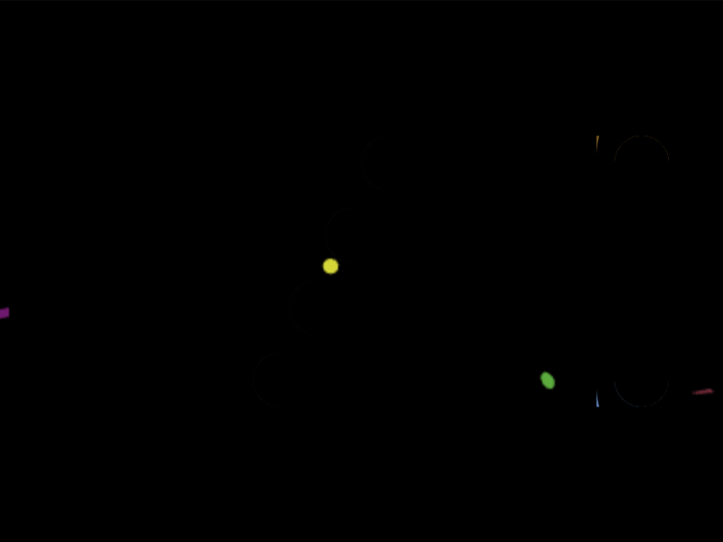

# Daily Target — Nov 10, 2026

Challenge: <https://cssbattle.dev/play/im5bpfWBaCfsHz3ynGXj>

## Result

<table>
	<tr>
		<th width="50%">User Submission</th>
		<th width="50%">Target</th>
	</tr>
	<tr>
		<td width="50%" align="center">
			
		</td>
		<td width="50%" align="center">
			
		</td>
	</tr>
</table>

## Code

```html
<style>
*{
  margin:195 30 75 140;
  border-radius:9in;
  box-shadow: 
    60px -120px #373737,
    40px -80px #FFF,
    20px -40px #373737,
    0 0 0 9in #A98955;
 *{
   margin: -120 0 0 200;
   box-shadow:
     inset 1in 0 #373737,
     20px 0 0 30px #A98955
     ;
     
   
 }
 }
```

## Prettified code

```html
<style>
*{
  margin:195 30 75 140;
  border-radius:9in;
  box-shadow: 
    60px -120px #373737,
    40px -80px #FFF,
    20px -40px #373737,
    0 0 0 9in #A98955;
 *{
   margin: -120 0 0 200;
   box-shadow:
     inset 1in 0 #373737,
     20px 0 0 30px #A98955
     ;
     
   
 }
 }
```
