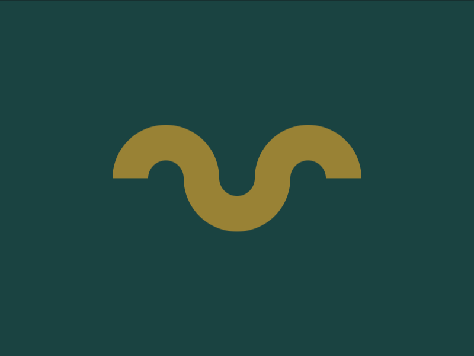

# Daily Target — Nov 17, 2026

Challenge: <https://cssbattle.dev/play/v4vfHaiNnku33Bu4ZxoO>

## Result

<table>
	<tr>
		<th width="50%">User Submission</th>
		<th width="50%">Target</th>
	</tr>
	<tr>
		<td width="50%" align="center">
			
		</td>
		<td width="50%" align="center">
			
		</td>
	</tr>
</table>

## Code

```html
<style>&{background:#1A4341;margin:97 102;[b]{scale:-1}img{margin:0-15;padding:15;border-radius:9in;border:32q solid#998235;clip-path:inset(0 0 50%
```

## Prettified code

```html

<style>
& {
  background: #1a4341;
  margin: 97 102;
  [b] {
    scale: -1;
  }
  img {
    margin: 0 -15;
    padding: 15;
    border-radius: 9in;
    border: 32Q solid #998235;
    clip-path: inset(0 0 50%);
  }
}
</style>
```
