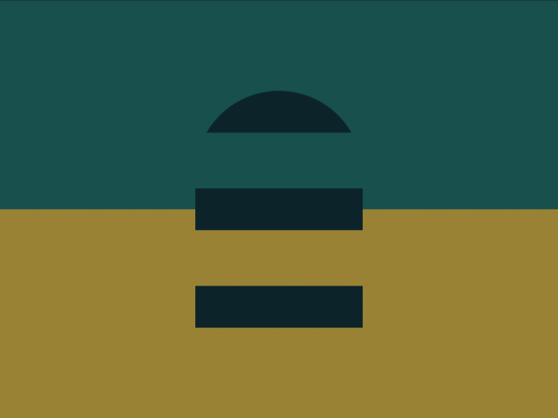

# Daily Target — Nov 20, 2026

Challenge: <https://cssbattle.dev/play/Xq0c8EROGbOq6rA5FlRC>

## Result

<table>
	<tr>
		<th width="50%">User Submission</th>
		<th width="50%">Target</th>
	</tr>
	<tr>
		<td width="50%" align="center">
			
		</td>
		<td width="50%" align="center">
			
		</td>
	</tr>
</table>

## Code

```html
<style>&{background:linear-gradient(#17504D 50%,#998235 0);*{margin:65 140;border-radius:9in 9in 0 0;background:linear-gradient(#0B2429 30px,#0000 0)0 0/100%70px
```

## Prettified code

```html
<style>
& {
  background: linear-gradient(#17504d 50%, #998235 0);
  * {
    margin: 65 140;
    border-radius: 9in 9in 0 0;
    background: linear-gradient(#0b2429 30px, transparent 0) 0 0 / 100% 70px;
  }
}

</style>
```
