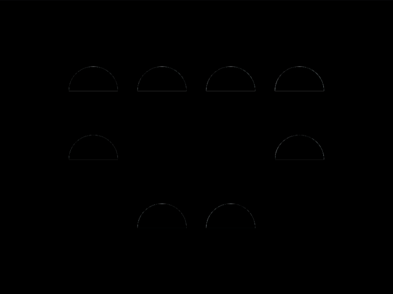

# Daily Target — Nov 21, 2026

Challenge: <https://cssbattle.dev/play/uzoOpbBnY8iXVAKpjzxS>

## Result

<table>
	<tr>
		<th width="50%">User Submission</th>
		<th width="50%">Target</th>
	</tr>
	<tr>
		<td width="50%" align="center">
			
		</td>
		<td width="50%" align="center">
			
		</td>
	</tr>
</table>

## Code

```html
<style>&{margin:68 70;outline:9in solid#90D3A6;background:radial-gradient(1q at bottom,#024817 25px,#90D3A6)-10px 24.5px/70px 70px;*{margin:25 50 24;color:90D3A6;box-shadow:inset 2in 0,-50vh 25vw,50vh 25vw
```

## Prettified code

```html
<style>
& {
  margin: 68 70;
  outline: 9in solid #90d3a6;
  background: radial-gradient(1Q at bottom, #024817 25px, #90d3a6) -10px
    24.5px / 70px 70px;
  * {
    margin: 25 50 24;
    color: 90D3A6;
    box-shadow:
      inset 2in 0,
      -50vh 25vw,
      50vh 25vw;
  }
}

</style>
```
