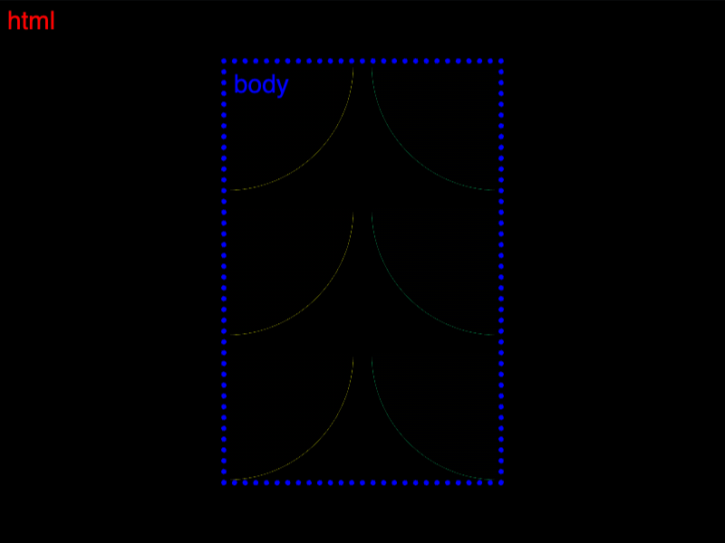

# Daily Target — Nov 22, 2026

Challenge: <https://cssbattle.dev/play/NeNTagiTiZfRt8dCPIqd>

## Result

<table>
	<tr>
		<th width="50%">User Submission</th>
		<th width="50%">Target</th>
	</tr>
	<tr>
		<td width="50%" align="center">
			
		</td>
		<td width="50%" align="center">
			
		</td>
	</tr>
</table>

## Code

```html
<style>&{background:#1d025e;*{margin:35 125;background:radial-gradient(1q at top,#0000 74q,#1D025E)75px 0/100%80px,conic-gradient(#43B6C7 50%,#F6DF96 0
```

## Prettified code

```html
<style>
& {
  background: #1d025e;
  * {
    margin: 35 125;
    background:
      radial-gradient(1Q at top, transparent 74Q, #1d025e) 75px 0 / 100% 80px,
      conic-gradient(#43b6c7 50%, #f6df96 0);
  }
}

</style>
```
